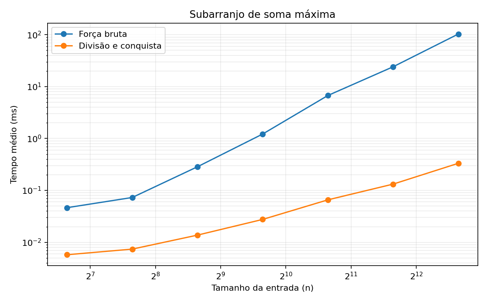
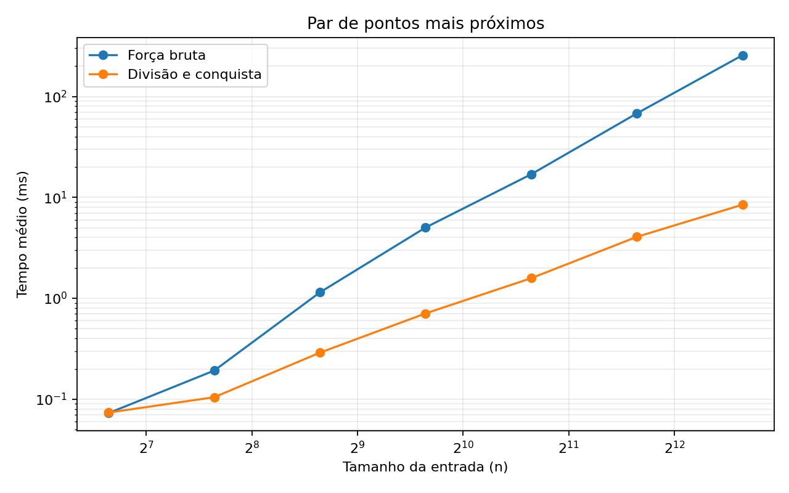

# Trabalho Prático: Divisão e Conquista

**Integrantes:** [nome 1] e [nome 2]  
**Disciplina:** [nome da disciplina]  
**Linguagem:** JavaScript (Node.js)  
**Prazo informado no enunciado:** 28/10/2026

## 1. Objetivo

O objetivo é implementar e comparar força bruta e divisão e conquista para dois problemas: subarranjo de soma máxima e par de pontos mais próximos. A análise compara as complexidades teóricas com tempos medidos em entradas crescentes.

## 2. Metodologia experimental

As implementações foram feitas em JavaScript e executadas com Node.js. Para cada tamanho e algoritmo, foram realizadas cinco amostras. Funções rápidas são medidas em pequenos lotes e o CSV registra o tempo médio por chamada, reduzindo o ruído do cronômetro. Os algoritmos são aquecidos antes das amostras. As entradas de benchmark são geradas deterministicamente e as respostas são comparadas antes de cronometrar.

Os arquivos `results/measurements.csv` e `results/summary.csv` guardam as medições brutas e as estatísticas resumidas. `results/machine.json` registra o ambiente utilizado. **Esta execução ocorreu em ambiente Linux virtualizado; antes da entrega, a dupla deve repetir os testes no computador que será descrito no relatório e regenerar as figuras.**

## 3. Etapa 1 — Subarranjo de soma máxima

### 3.1 Força bruta

A solução enumera todos os índices iniciais e finais. Ao avançar o fim do intervalo, mantém a soma acumulada, evitando recalcular cada soma desde o começo. Existem `n(n+1)/2` intervalos, portanto o tempo é `Θ(n²)` e o espaço auxiliar é `Θ(1)`.

### 3.2 Divisão e conquista

O vetor é dividido em duas metades. A resposta está inteiramente na metade esquerda, inteiramente na direita ou cruza o meio. Para o caso cruzado, calcula-se em tempo linear o melhor sufixo da metade esquerda e o melhor prefixo da metade direita. Retorna-se o melhor dos três candidatos.

A recorrência é `T(n) = 2T(n/2) + Θ(n)`. Pelo Teorema Mestre, o tempo é `Θ(n log n)`. A pilha recursiva usa `Θ(log n)` espaço.

### 3.3 Casos de borda e convenções

Os índices começam em zero e o índice final é inclusivo. Em empate de soma, vence o intervalo com menor índice inicial e, persistindo o empate, o menor índice final. Vetores com apenas números negativos retornam o elemento menos negativo. Os testes incluem vetor unitário, todos negativos, zeros, todos positivos, empate e intervalo que cruza a divisão.

### 3.4 Resultados

Tempo médio por chamada, em milissegundos:

| n | Força bruta (ms) | Divisão e conquista (ms) |
|---:|---:|---:|
| 100 | 0.046453 | 0.005760 |
| 200 | 0.073037 | 0.007393 |
| 400 | 0.285409 | 0.013757 |
| 800 | 1.219414 | 0.027591 |
| 1600 | 6.743752 | 0.065790 |
| 3200 | 24.099554 | 0.132163 |
| 6400 | 103.063674 | 0.332856 |



A força bruta cresce de forma aproximadamente quadrática, pois avalia todos os intervalos. A divisão e conquista cresce mais lentamente, conforme esperado para `Θ(n log n)`. Pequenas oscilações são normais em medições de curta duração e em ambientes compartilhados; por isso, a análise considera a tendência de vários tamanhos, não um único ponto.

## 4. Etapa 2 — Par de pontos mais próximos

### 4.1 Força bruta

A solução compara todos os pares distintos de pontos, totalizando `n(n−1)/2` comparações. A complexidade temporal é `Θ(n²)`. As distâncias são comparadas pelo quadrado da distância, evitando calcular raízes quadradas em cada comparação.

### 4.2 Divisão e conquista

Primeiro, os pontos são ordenados por x e por y. A lista ordenada por x é dividida em duas metades; cada metade é resolvida recursivamente. A menor distância obtida define `δ`. Na combinação, considera-se a faixa com distância horizontal de até `δ` da linha divisória, já ordenada por y, e cada ponto é comparado com no máximo os sete pontos seguintes.

O limite de sete decorre de um argumento geométrico de empacotamento: como cada metade já tem distância mínima `δ`, não podem existir dois pontos da mesma metade separados por menos de `δ`. Dentro da região relevante da faixa, essa restrição limita a quantidade de pontos que precisam ser considerados na vizinhança vertical. Assim, a combinação é linear.

A ordenação inicial custa `Θ(n log n)` e a recorrência da etapa recursiva é `T(n) = 2T(n/2) + Θ(n)`, resultando em `Θ(n log n)` no total. Para subproblemas com até três pontos, usa-se força bruta: são no máximo três pares, custo constante, e evitam-se chamadas recursivas desnecessárias.

### 4.3 Casos de borda e convenções

A entrada deve conter pelo menos dois pontos com coordenadas finitas. Os índices retornados são baseados em zero e indicam a posição dos pontos na entrada. Pontos duplicados são permitidos; nesse caso, a distância mínima é zero. Se vários pares tiverem a mesma distância mínima, qualquer par que atinja essa distância é válido. Os testes cobrem pares horizontais, verticais e diagonais, pontos colineares, duplicatas, empates e um par que cruza a divisão.

### 4.4 Resultados

Tempo médio por chamada, em milissegundos:

| n | Força bruta (ms) | Divisão e conquista (ms) |
|---:|---:|---:|
| 100 | 0.072812 | 0.073701 |
| 200 | 0.192241 | 0.104598 |
| 400 | 1.144405 | 0.289126 |
| 800 | 5.028482 | 0.707849 |
| 1600 | 16.958648 | 1.582213 |
| 3200 | 67.987173 | 4.064112 |
| 6400 | 256.680733 | 8.467707 |



A força bruta cresce rapidamente porque o número de pares é quadrático. A divisão e conquista tem custo de ordenação e recursão para entradas pequenas, mas passa a ser mais eficiente conforme o número de pontos cresce. Os resultados desta execução mostram essa tendência nos tamanhos maiores.

## 5. Testes e validação

A suíte automatizada contém **42 testes**, todos aprovados nesta execução. Ela inclui casos de borda e compara as implementações dos dois problemas. Para soma máxima, foram enumerados vetores pequenos para verificar que a divisão e conquista coincide com a força bruta. Para pontos mais próximos, foram usados casos determinísticos e entradas pseudoaleatórias reproduzíveis; a validação compara a distância mínima e confirma que o par retornado corresponde aos índices informados.

Para executar novamente:

```bash
npm test
npm run benchmark
python3 tools/plot-results.py
```

## 6. Conclusão

Os resultados são compatíveis com a análise assintótica: força bruta tem complexidade `Θ(n²)` nos dois problemas, enquanto as soluções de divisão e conquista têm complexidade `Θ(n log n)`. A diferença de desempenho torna-se mais clara em entradas maiores, especialmente no problema dos pontos mais próximos, em que a força bruta precisa examinar todos os pares.

Antes da entrega, a dupla deve repetir as medições no computador que será informado, regenerar os CSVs e os gráficos, preencher os nomes dos integrantes e revisar a formatação final do relatório em PDF de até oito páginas.
